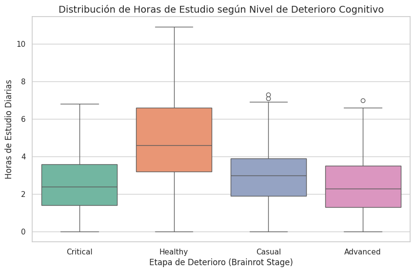
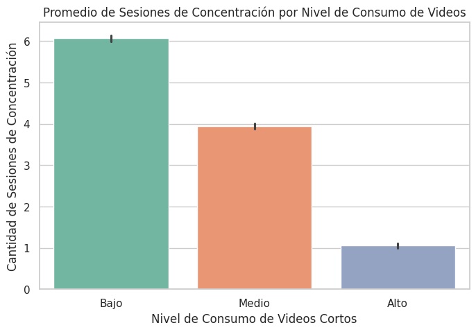
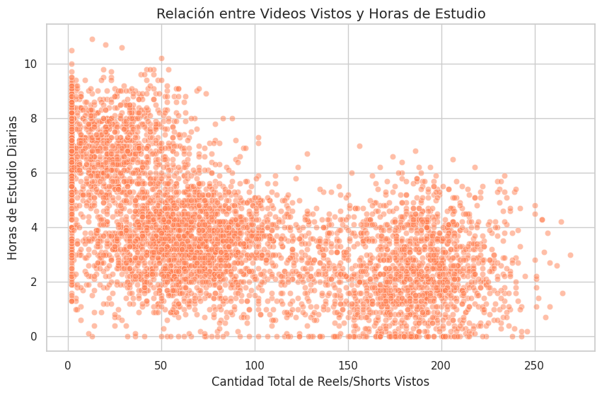

# TP LABO — Consumo de videos cortos y atención mental

## Trabajo práctico de análisis de datos

**Asignatura:** Laboratorio de Métodos Cuantitativos Aplicados a la Gestión  
**Año:** 2026  
**Integrantes:** Esther Kikushima · Martín Pina

---

## Descripción del proyecto

Este repositorio contiene el desarrollo del trabajo práctico de análisis exploratorio de datos, orientado a estudiar la relación entre el consumo de videos cortos y determinados indicadores vinculados al estudio, la concentración y el funcionamiento cognitivo.

El proyecto utiliza herramientas de Python y Pandas para explorar, transformar, integrar y analizar un conjunto de datos estructurado en distintas tablas. A partir de este procedimiento, se construyen visualizaciones que permiten identificar patrones y asociaciones descriptivas entre las variables seleccionadas.

El análisis se desarrolla con un enfoque exploratorio y descriptivo, sin establecer relaciones causales.

## Pregunta de investigación

¿Qué patrones descriptivos aparecen entre el consumo de videos cortos, las horas de estudio y las sesiones de concentración?

## Estructura del repositorio

```text
TP-LABO/
│
├── README.md
├── index.html
├── styles.css
├── script.js
│
├── data/
│   ├── Fact_User_Activity.csv
│   ├── Dim_Users.csv
│   ├── Dim_MentalState.csv
│   ├── Dim_Habits.csv
│   └── Dim_Date.csv
│
└── assets/
    ├── grafico1_distribucion.png
    ├── grafico2_barras.png
    └── grafico3_dispersion.png
```

## Metodología

El trabajo se desarrolla mediante las siguientes etapas:

1. **Exploración inicial:** identificación de dimensiones, columnas, tipos de datos y estructura de las tablas.
2. **Control de calidad:** revisión de valores faltantes y registros duplicados.
3. **Integración de datos:** combinación de la tabla de actividad con las dimensiones pertinentes mediante `pd.merge()`.
4. **Transformación:** categorización de la cantidad de videos vistos mediante `pd.qcut()`, generando los niveles Bajo, Medio y Alto.
5. **Análisis descriptivo:** agrupación de registros con `groupby()` y cálculo de promedios mediante `mean()`.
6. **Visualización:** construcción de gráficos estadísticos para explorar distribuciones y asociaciones entre variables.
7. **Interpretación:** elaboración de conclusiones y delimitación de los alcances del análisis.

## Visualizaciones

### 1. Distribución de horas de estudio según Brainrot Stage

Boxplot utilizado para comparar las distribuciones de horas de estudio diarias entre las categorías de estado mental.

### 2. Promedio de sesiones de concentración por nivel de consumo

Gráfico de barras que representa los promedios de sesiones de concentración para los grupos de consumo Bajo, Medio y Alto.

### 3. Relación entre videos vistos y horas de estudio

Diagrama de dispersión que permite observar la asociación entre la cantidad total de videos vistos y las horas de estudio diarias.

## Tecnologías utilizadas

- Python
- Pandas
- Matplotlib
- Jupyter Notebook
- Google Colab
- HTML
- CSS
- JavaScript
- Git y GitHub

## Alcances y limitaciones

Los resultados obtenidos corresponden a un análisis exploratorio y descriptivo del dataset utilizado.

Las asociaciones observadas no permiten establecer causalidad. Asimismo, las horas de estudio no constituyen una medida directa del rendimiento académico y los indicadores cognitivos se interpretan exclusivamente según las definiciones disponibles en los datos.

El análisis tampoco contempla el control de factores externos que podrían intervenir en las relaciones observadas.

## Sitio web del proyecto

El repositorio incluye una página web complementaria que presenta el planteamiento del trabajo, la estructura de los datos, el procedimiento metodológico, las visualizaciones y las principales conclusiones.

La página puede publicarse mediante **GitHub Pages**.

---

*Trabajo práctico académico — 2026*

## Dataset

Los archivos utilizados en el análisis se encuentran en la carpeta `data/`.

- [Fact_User_Activity.csv](data/Fact_User_Activity.csv)
- [Dim_Users.csv](data/Dim_Users.csv)
- [Dim_MentalState.csv](data/Dim_MentalState.csv)
- [Dim_Habits.csv](data/Dim_Habits.csv)
- [Dim_Date.csv](data/Dim_Date.csv)

## Visualizaciones

Los gráficos generados durante el análisis se encuentran en `assets/`.






